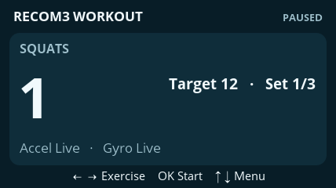

# Recom3Workout

An offline workout HUD for the original Recon Jet. It counts candidate pull-ups, squats and push-ups from the goggles' motion. Each exercise has its own locally saved profile. The included profiles are experimental and unvalidated against real exercises.

## HUD preview



Version 0.1.8 uses a high-contrast white and green dumbbell launcher icon with a transparent background. Standard-density PNG resources give the legacy Jet launcher fixed icon dimensions.

## Build and install

The project inherits Recom3Ghost's Java 7 source level, Gradle 4.1, Android Gradle Plugin 3.0.1, compile SDK 27, Build Tools 27.0.3 and minimum and target API 16. Use JDK 8. Set `JAVA_HOME` and `ANDROID_HOME`.

```powershell
.\gradlew.bat :app:assembleDebug
adb install -r app/build/outputs/apk/debug/app-debug.apk
adb shell am start -n com.recom3.workout/.WorkoutActivity
```

The package is `com.recom3.workout`. Application updates must retain the existing package and signing identity. The test APK for version 0.1.15 / code 16 is available locally at `build/installer/Recom3Workout-0.1.15-api16.apk`.

Recom3Workout also provides a RIF installation package through the private release workflow. Distribution artifacts are generated locally and are not automatically installed or published. The catalog thumbnail is a transparent 64 × 64 PNG in `docs/recom3workout.png`.

## ICE3 workout results

Version 0.1.12 adds an app-private persistent queue of completed-workout JSON objects. A bounded worker submits them through the existing Recon OBJECT service at startup and on workout completion. Sessions are marked synced only after a matching durable-storage acknowledgement; unavailable ICE3 leaves them pending. The existing CSVs remain unchanged and are never deleted after sync. Completed archived workouts are also recovered into the queue on startup.

The glasses sender is implemented. **ICE3 iOS was inspected read-only: its OBJECT framing is compatible, but it does not yet persist workouts or return the required acknowledgement. End-to-end iOS synchronization has not been validated.** The receiver must add the workout action, safe local persistence, deduplication and acknowledgement described in [the schema and receiver contract](docs/ice3-sync.md). No other repository is modified, and no APK is automatically deployed.

## Receive Web routines from ICE3

Version 0.1.13 / code 14 receives Snow3's existing TEMPLATE protocol over Recon OBJECT, validates and atomically saves the complete routine, then sends TEMPLATE_STORED. A persistent review screen shows each exercise and set; OK accepts the complete snapshot, Back/Later keeps the current workout. **New workout** uses only approved individual targets (1–20 sets, 1–100 reps); an already started session keeps its goals. Without a synced routine, local goals remain available. A stored routine waiting to be applied shows **NEW ROUTINE**; a session started from an accepted routine keeps a **WEB** origin label. The local **Replace synced routine** confirmation supports changing ICE3 user/device without treating routine IDs as account identity.

The Jet preserves 100-rep targets, but the current Snow3 result receiver still caps target fields at 99. Results containing a 100 target remain pending until that separate phone/API compatibility follow-up; they are never clamped.

See [the protocol, safe handoff policy and real-device test steps](docs/template-sync.md). Result JSON schema 1 and the existing session sync queue are unchanged. Historical/uniform CSVs retain their format; numbered PLAN rows preserve nonuniform future targets in new sessions.

## Dynamic exercise runtime (0.1.14 / code 15)

Workout now supports bounded routines with 1–8 data-defined repetition exercises, individual targets and independent persistent local calibration. A previously unknown ID starts with a deep copy of the user's saved Pull-ups profile, marked **experimental/unvalidated**; changing it never changes Pull-ups. Calibration now also exposes direction, filtering, preparation and the installed detector mode, including Manual. Preview and Congrats support N exercises with pagination.

Version **0.1.15 / code 16** connects the existing dynamic-result outbox to Recon OBJECT. Each result first requires the exact ICE3 capability response, then a matching durable receipt for the original saved bytes. **Stored in ICE3** means local phone storage; server upload is independent. Menu → **Retry results** retries saved results without starting another workout. Oversized, incompatible, timed-out or failed deliveries remain local. See [the result negotiation and receipt contract](docs/results-v2-sync.md). The existing ICE3 v1 circuit and routine acceptance are preserved. See [the exact development contract, storage and limitations](docs/dynamic-exercises.md). No new server endpoint or downloaded executable code is involved. This release does not establish Dips detection accuracy.

## Controls

The app accepts the same Select/OK key events as Recom3Ghost. Use the Jet's directional touchpad swipes or equivalent D-pad inputs. [Recon Jet owner manual](https://fccid.io/m/895259af0d76fda203311f4ed5b2657f051e1a39543cc581d18ee9abe695fe49.pdf)

| Screen | Controls |
| --- | --- |
| Workout | Left/Right selects an exercise while paused and restores its set progress. OK starts or pauses. Up/Down opens the menu and pauses detection. Back pauses a running workout or exits from the paused HUD. |
| Menu | Move with the directions and press OK to select Workout setup, add or subtract a rep, reset the current set, advance to the next set, open Diagnostics or Calibration, export CSV files, retry saved results, or start a new workout. Back returns to the workout. |
| Workout setup | Up/Down selects Exercise, Set, Target reps or Total sets. Left/Right changes the selected value. Targets save per set; other existing targets are retained. Back returns to the menu. |
| Diagnostics | OK starts a recording, then adds one ground-truth marker per press. Right saves and stops. Back saves and returns to the menu. |
| Calibration | Up/Down selects a field, Left/Right adjusts it, and Back returns to the menu. Changes save immediately for the current exercise. |
| Congrats | Left/Right or Up/Down changes summary pages. OK starts a new workout after CSV export succeeds. If export is pending, OK retries it. Back returns to the HUD for review. |
| Routine review | Left/Right changes exercise (1/N is the first of N exercises), Up/Down scrolls sets, OK accepts the whole routine, Back keeps it for later. |
| Replace synced routine | OK permits one valid incoming routine to replace the saved context for two minutes; Back cancels. The current workout stays unchanged. |

Set completion saves the result, pauses counting and automatically prepares the next set with a zero counter. After the last set of an exercise, the app selects the next unfinished exercise in routine order, skipping completed exercises and wrapping as needed. The legacy cycle is Squats → Push-ups → Pull-ups → Squats. Press **OK** when ready to start each set. Left/Right can still select an exercise while paused. The fallback is three sets with targets of 8 pull-ups, 12 squats or 10 push-ups per set. Completed sets, exercise goals and the active workout survive relaunch. Keep the app in the foreground while detecting or recording.

A workout includes exactly the exercises in its saved routine. Legacy/fallback routines include all three original exercises; dynamic routines may contain a different number. You can alternate exercises in rounds or complete each exercise in turn. **Congrats** appears when every exercise's set goal is complete and shows the actual totals. Four sets of 10 squats, 5 push-ups and 4 pull-ups produce 40, 20 and 16 repetitions, or 76 in total.

**Add a rep** and **Subtract a rep** correct the current counter. Corrections to an already completed set also update its saved result. **Reset reps** reopens that set. **Next set** can explicitly end a partial set, whose actual count is saved with a MANUAL reason. **New workout** starts a fresh routine and retains earlier completed-set records in the archive.

In Diagnostics, the detector runs during recording and pauses when recording is saved or a write fails. Sensor values remain live while paused. Returning to the app requires starting a new recording to resume diagnostic counting.

## Workout CSV files

Normal workouts save a CSV after each completed set to the app's external-files directory. An internal CSV archive preserves the completed sets if external export fails. Use **Export CSV** to copy saved workouts again when storage is available.

```powershell
adb pull /sdcard/Android/data/com.recom3.workout/files/workouts ./workouts
```

Legacy CSVs contain PLAN rows for exercise goals, SET rows with set numbers, actual repetitions and completion timestamps, SUMMARY rows per exercise and a TOTAL row. Timestamps include Unix milliseconds and UTC text. Dynamic CSVs use the separate self-contained v2 snapshot described in [dynamic-exercises.md](docs/dynamic-exercises.md). TARGET means the counter reached the rep goal, MANUAL identifies an explicit advance to the next set, and CORRECTED identifies an edited completed count. Completed-set targets stay recorded when goals for remaining sets change.

Workout CSV files are stored locally for later upload. Raw sensor recordings remain available under the separate `files/recordings` directory.

Adopt the workout posture before starting detection or recording. Hold still until the HUD's **Hold still to start** message clears or Diagnostics changes from **HOLD_STILL** to **READY**. The detector waits for a quiet sensor reference at startup. Save or pause before getting up after a set. The push-up peak-to-peak default is 2.00 m/s² to reduce counts caused by smaller head movements.

## Sensors and detection

- `WorkoutActivity` registers available Android sensors at a requested 25 ms interval, computes delivered rates from sensor timestamps, and handles controls, lifecycle and local preferences. The fullscreen, scaled Canvas HUD and Recon UI font module come from Recom3Ghost's design.
- `MotionEngine` estimates gravity in goggles coordinates from all three acceleration axes. Fresh gyroscope samples propagate the gravity direction through head rotations. A slow accelerometer correction also provides the fallback when the gyro is missing or stale. The engine projects acceleration onto the gravity direction, subtracts a measured resting baseline and low-pass filters the result. Hold still briefly when opening Diagnostics, starting an exercise after changing it, or recovering from a sensor interruption.
- During quiet intervals, the engine updates the measured resting baseline from an 800 ms sensor window. This recovers from startup motion that would otherwise leave a constant vertical offset and prevent the detector from rearming. Baseline updates are suspended during an active repetition cycle.
- `RepDetector` uses an exercise-specific movement direction, trigger, neutral band, peak-to-peak amplitude, cycle time and debounce. After neutral arming, it looks for outbound acceleration, reversal, return braking and settling. It clears partial cycles on reset, pause and sample gaps. No position estimate is integrated from acceleration.
- Without a working accelerometer, manual count and workout controls remain available. Diagnostics uses a separate detector so trial runs leave the workout count intact.

## Record and calibrate

1. Choose the exercise, open **Diagnostics**, let the sensor readings settle, then press **OK** to record.
2. Press **OK** once per completed rep to mark its approximate completion time. Include stillness, head turns, incomplete reps, and varied tempos in separate trials. Marker presses can themselves introduce motion.
3. Save with **Right**. Pull the recordings directory over USB. The save message in `adb logcat -d -s Recom3Workout:I` includes the exact file path.

```powershell
adb pull /sdcard/Android/data/com.recom3.workout/files/recordings ./recordings
```

Each CSV starts with a `CONFIG` row containing the exercise and active thresholds. `ACCEL` and `GYRO` rows preserve each stream's raw XYZ, timestamp in nanoseconds, elapsed receipt time in milliseconds, latest filtered vertical signal, detector state and count. Accelerometer fields use m/s² and gyro fields use rad/s. `MARK` rows share the elapsed receipt timeline and have sequential marker numbers. A difference in receipt time can occur across the two asynchronous streams. Exiting the screen or backgrounding the app closes an active recording.

Compare detection transitions against the marked cycles and tune one profile at a time. The trigger sets the signed phase-crossing magnitude. The neutral band and debounce govern settling and rearming. Peak-to-peak is total signal swing in m/s². Cycle times are in milliseconds. Long pauses at turnarounds, closely spaced reps, head motion and small vertical displacements can produce misses or false counts. Head motion is an indirect measure of each exercise.

## Verification

```powershell
.\checks\run.ps1
```

The 47 dependency-free JVM checks cover full and partial movements, minimum amplitude, noise, orientation, fast and slow cycles, state transitions, debounce, pause/resume, reset, gaps, recovery from a biased startup baseline, arming after stabilizing the workout posture, noisy settling, consecutive cycles with brief neutral crossings, preparing for pull-ups with small bar vibrations, linked pull-up cycles and the bounded preparation interval for pull-ups.

Version 0.1.9 adds 29 session checks for complete routines, actual totals, save retries, count corrections, goal changes, CSV round trips, interrupted writes, archive retention and recovery from an external export failure.

Version 0.1.10 adds automatic progression after saving a set, while each new set waits for OK. Five additional session checks cover remaining sets, exercise changes, wraparound, skipping finished exercises and final completion. Motion detection profiles are unchanged.

Version 0.1.11 packages that behavior for Uplink with versionCode 12, a 64 × 64 catalog thumbnail and a generated catalog update SQL file. It retains the existing package ID and signing certificate.

On the original API 16 Jet, setup changes survived a relaunch. An isolated simulated workout with 12 sets triggered Congrats with 40 squats, 20 push-ups and 16 pull-ups. The exported CSV contained those same 76 total repetitions, and repeating export preserved the file contents. This verifies session handling and presentation; it does not add new motion-accuracy validation.

Version 0.1.2 replays two real Jet recordings of six squats each as six detections per recording, with zero extra detections in the final quiet intervals. The original recordings contained counts of one and zero. The updated squat neutral-band default is 0.38 m/s². Saved calibration values remain configurable.

Version 0.1.3 replays the two initial push-up recordings as five and seven repetitions using the new 2.00 m/s² amplitude setting. The recorded counts were six and eight. The initial positioning count and the final small-motion count are excluded. All three six-squat recordings still replay as six. These were recording replay results before the subsequent live trials.

Version 0.1.4 fixes a missed-count problem found during the next push-up trial. A return that has reached the neutral band can finish through small oscillations within the trigger threshold, or as the next complete movement begins. Consecutive repetitions can start during debounce while the minimum cycle duration, amplitude and interval between counts remain enforced. The earlier push-up and squat recording results are preserved. The latest push-up recording replays as six motion cycles. Its actual repetition count was uncertain, so that result is a signal regression check. Subsequent live validation used a series with exactly five repetitions.

The next exact five-push-up trial recorded five detections on version 0.1.4. Version 0.1.5 adjusts preparation for pull-ups, whose first four-repetition trial stayed in HOLD_STILL throughout the exercise. Pull-ups now use a 250 ms preparation window with a 0.36 (m/s²)² variance limit and a 0.12 s low-pass time constant. Squats and push-ups use 500 ms, 0.16 (m/s²)² and 0.065 s. The pull-up state machine accepts positive acceleration, reversal and positive bottom braking as a full cycle and seeds the next cycle from that braking phase. With a trigger of 0.55 m/s² and a peak-to-peak amplitude of 2.00 m/s², replay detects four cycles in that pull-up recording and zero further counts during its final quiet period. A new live pull-up trial is still needed. Distinguishing household movement from exercise also needs separate recordings.

The second live four-pull-up trial on 0.1.5 again remained in HOLD_STILL during the exercise because the gyroscope condition never accepted the preparation window. Version 0.1.6 bounds pull-up preparation to one second. If no quiet window is available by then, it uses the median of the recent projected acceleration as a reference and starts detection. It also clears previous sensor-estimation state when starting or resetting a pull-up series. Both four-repetition recordings replay as four. Push-up and squat preparation retains its existing quiet-window behavior. Further live validation and household-movement recordings remain necessary.

The following live four-pull-up recording on 0.1.6 recorded four detections. Extra detections observed while walking back occurred after saving, when the diagnostic preview was still counting. Version 0.1.7 pauses the diagnostic detector outside active recordings, including after a save, a recording error or a return from the background. The normal workout HUD continues to use OK for start/pause and pauses automatically at the rep target.

The user confirmed that version 0.1.7 worked correctly in normal workout mode on the original Jet during a test of one set each of 10 squats, 5 push-ups and 4 pull-ups. These were locally configured test targets. Repetition and set targets can be changed in Calibration.

To verify a local recording against a known count, run the checks with its path and the start of the final quiet interval in milliseconds. The replay uses the raw accelerometer and gyro rows and the settings stored in the CSV.

```powershell
.\checks\run.ps1 -Recording ./recordings/squats.csv -ExpectedReps 6 -QuietAfterMs 26000
.\checks\run.ps1 -Recording ./recordings/push-ups.csv -ExpectedReps 7 -QuietAfterMs 20000 -Amplitude 2.00
.\checks\run.ps1 -Recording ./recordings/pull-ups.csv -ExpectedReps 4 -QuietAfterMs 10000 -Amplitude 2.00 -Trigger 0.55
```

The standalone Windows build produced a signed debug APK whose v1 signature verified for API 16. The offline Gradle build could not resolve the legacy Android Gradle Plugin 3.0.1.

The APK installed and launched on an original Recon Jet reporting API 16. A stationary test measured 38.9 Hz on each sensor and exported raw samples and one manual marker. The detector armed and reported zero reps during that capture. ADB-injected D-pad events verified exercise selection, start/pause, manual correction, set advancement and navigation to calibration and diagnostics. Broader validation across users, motion styles and incidental movement remains necessary.

## Licenses

- Recom3Workout and its Recom3Ghost base are distributed under the [MIT License](LICENSE).
- The bundled Recon UI code is covered by the [Artistic License 2.0](reconUI/LICENSE).
- The bundled Open Sans fonts are covered by the [Apache License 2.0](reconUI/LICENSE-OpenSans.txt).
